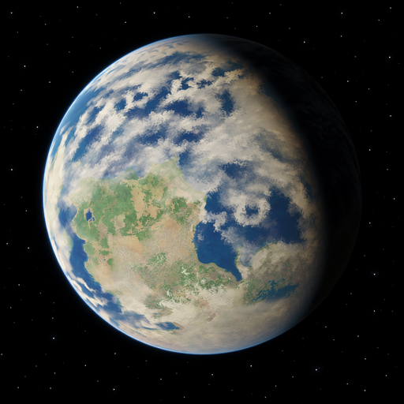
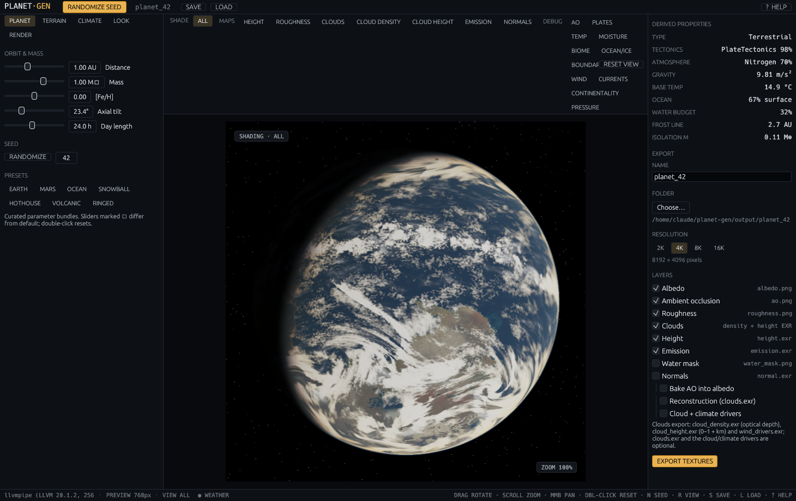
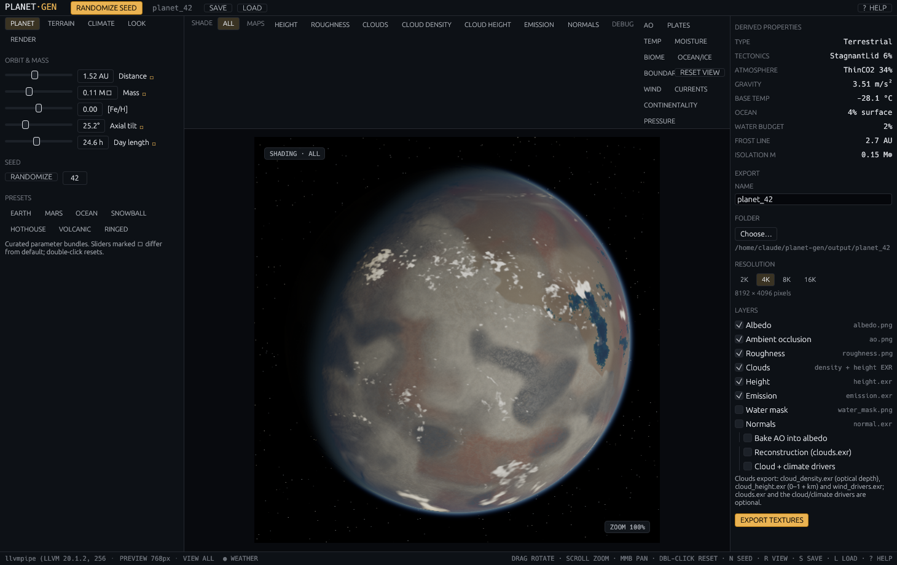
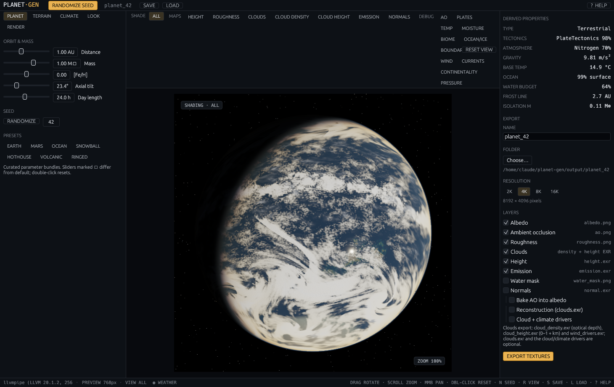
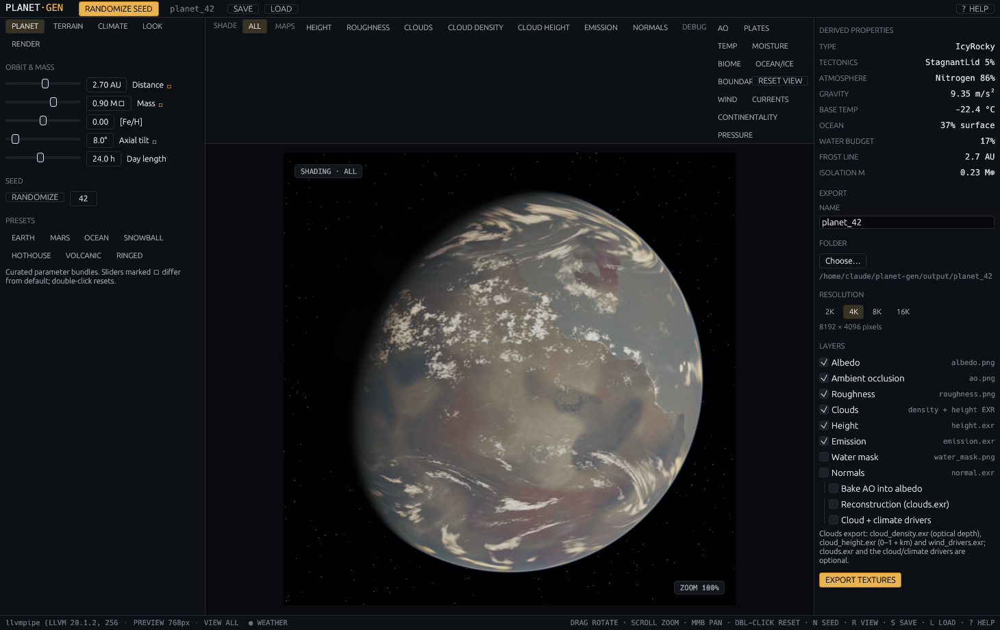
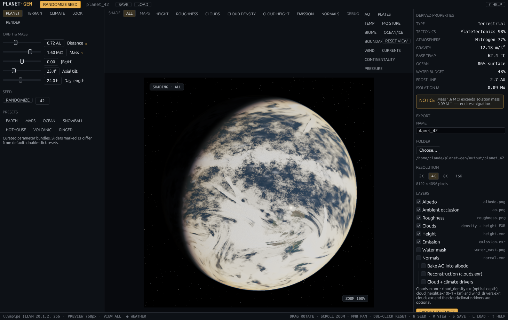
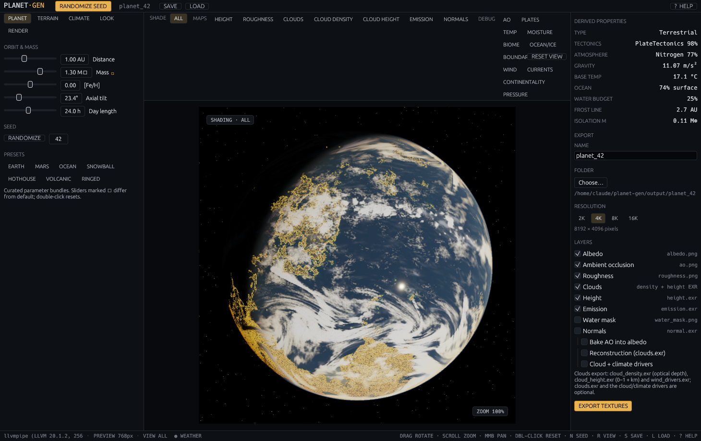
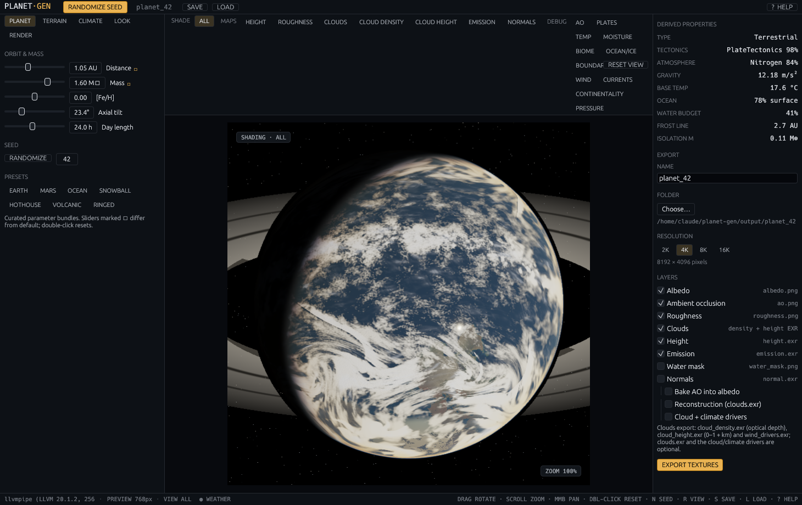
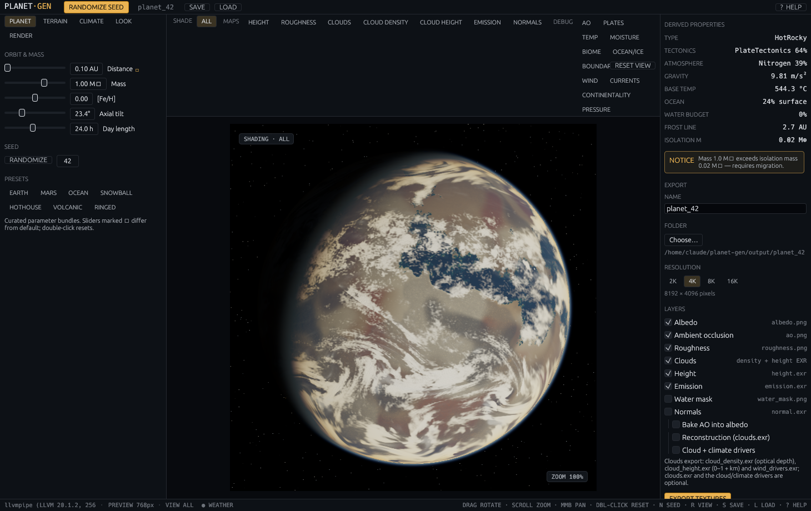
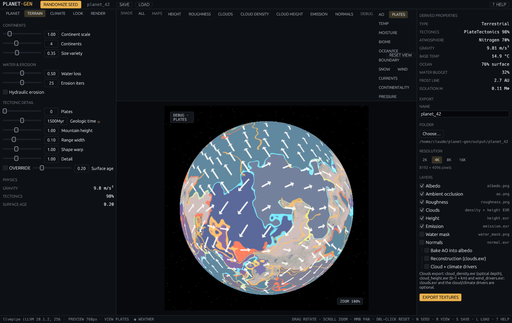

# Planet Gen

<p align="center">
  
</p>

GPU-accelerated procedural planet generator for VFX. Produces physically plausible rocky planets with plate tectonics, terrain, biomes, climate, weather-driven clouds, and oceans from a handful of input parameters, and exports them as equirectangular textures up to 16K.

Built with Rust, wgpu (WebGPU), and egui.

<p align="center">
  
</p>

## Quick Start

```
cargo run --release --bin planet-gen
```

Requires a GPU with Vulkan, Metal, or DX12 support (most GPUs from 2018+) and OpenEXR for the native EXR writer:

- **Linux:** `apt install libopenexr-dev pkg-config`
- **macOS:** `brew install openexr`
- **Windows:** `vcpkg install openexr:x64-windows`, then point `OPENEXR_INCLUDE_DIR` / `OPENEXR_LIB_DIR` at the install (see `.github/workflows/ci.yml`)

## Features

**Terrain and tectonics**
- **Plate-driven continents** — Voronoi plates on the sphere; plate type sets land/ocean elevation with smooth boundary blending, mountain ranges, rifts, and ocean-floor detail
- **Plate motion history** — the Geologic time slider runs plates about Euler poles for up to billions of years: continents drift, collide into supercontinents and rift apart again, leaving sutures, volcanic arcs, and eroded mountain belts
- **Plates view** — plate tint, boundary types, and per-plate velocity arrows, mirroring the terrain shader's plate assignment
- **Continent controls** — number of continents (1-10), size variety (equal sizes to supercontinent plus islands), and continental scale
- **Progressive erosion** — GPU hydraulic erosion with moisture-weighted intensity

**Climate and surface**
- **Hadley cell climate** — latitude-driven temperature, pressure-gradient wind with Coriolis and terrain deflection, rain shadows, continentality
- **Whittaker biome system** — temperature × moisture lookup with altitude zonation (forest, alpine, rock, snow) and polar ice
- **Atmosphere** — Mie scattering haze and star color temperature tinting from blue O-stars to red M-dwarfs
- **Night lights** — procedural city lights with cloud occlusion and scattered glow
- **Lava glow, ocean sun glint, rings** — volcanic emission along plate boundaries, PBR specular on water, Saturn-like rings with gaps, tilt, and planet shadow

**Clouds**
- **Weather solver** — persistent GPU weather fields drive bounded ray-marched stratus, convection, and cirrus with lighting and surface shadows
- **Cloud synthesis** — Clouds > Structure rebuilds each column with weather systems on top of the solver: storm-track cyclones with comma heads, fronts, and dry slots, ridges, tropical cyclones, ITCZ convective clusters, west-coast stratocumulus decks, open cells, cumulus fields, and jet cirrus; detail is resolution-independent, so 2K and 16K agree
- **Cloud detail** — physical optical depth with two-stream shading and billow erosion turns thin veils into bright decks and broken cumulus in the preview; Clouds > Advanced > Thin lift raises faint cloud in both preview and export

**Workflow**
- **Instrument-panel UI** — tabbed control rail (Planet, Terrain, Climate, Look, Render), live derived properties, curated presets, and a help overlay (F1 or `?`)
- **Save and load planets** — every parameter and the viewport state go to a JSON planet file
- **Selective texture export** — albedo, AO, roughness, cloud density and height, height, emission, water mask, and normals at 2K, 4K, 8K, or 16K, into a folder you choose (remembered between sessions)
- **Smooth AO** — `ao.png` is a broad, hill-scale occlusion field without pixel speckle; it can optionally be baked into the albedo
- **Blender add-on** — one-click import of exported textures with an auto-wired Principled BSDF, plus a cloud bridge that adds billow detail to the exported clouds at render time

## Planet Types

The app ships with curated presets (Planet tab → PRESETS). Each preset is a full parameter bundle; the physics model derives type, tectonics, atmosphere, and climate from distance, mass, and metallicity. All screenshots use seed 42.

| Preset | Type | Screenshot |
| --- | --- | --- |
| **EARTH** — 1.0 AU, 1.0 M⊕ | Terrestrial · PlateTectonics · 14.9 °C |  |
| **MARS** — 1.52 AU, 0.11 M⊕, dry & cold | Terrestrial · StagnantLid · ThinCO₂ |  |
| **OCEAN** — no water loss, few landmasses | Terrestrial · 99% ocean |  |
| **SNOWBALL** — 2.7 AU, tilted-cold axis | IcyRocky · StagnantLid · −22 °C |  |
| **HOTHOUSE** — 0.72 AU, 1.6 M⊕, overcast | Terrestrial · 62 °C base temp |  |
| **VOLCANIC** — 26 plates, lava emission | Terrestrial · volcanic glow at plate boundaries |  |
| **RINGED** — 1.05 AU, 1.6 M⊕ with ring system | Terrestrial · Saturn-like rings |  |
| **HOT ROCKY** — Earth preset at 0.10 AU (Distance slider) | HotRocky · 544 °C |  |

### Plate history

The Terrain tab's Geologic time slider replays plate motion before the present day. The PLATES view shows plate tint, plate boundaries, and each plate's velocity. Earth preset after 1,500 Myr of plate motion:

<p align="center">
  
</p>

## Usage

The app opens with a tabbed control rail on the left, the 3D preview in the middle, and derived properties plus export settings on the right. Sliders marked with a dot differ from their default; double-click a slider to reset it.

**Planet:** Distance (AU), Mass (M⊕), stellar metallicity [Fe/H], Axial tilt, Day length, Seed, and Presets.

**Terrain:**
- **Continents** — Continent scale, number of continents (1-10), size variety (0 = equal sizes, 1 = supercontinent + islands)
- **Water & erosion** — Water loss (0 = ocean world, 1 = no surface water), erosion iterations, hydraulic erosion toggle
- **Tectonic detail** — plate count (0 = auto from mass), Geologic time (Myr of plate motion), mountain height, range width, shape warp, detail, optional surface age override

**Climate:**
- **Atmosphere** — moisture and season
- **Clouds** — Coverage, Opacity, Detail (0 = raw weather field, 1 = billowed margins and bright cores), Structure (0 = the solver's raw field, 1 = weather systems and cloud regimes, preview and export), Advanced > Thin lift, wind strength and transport
- **Storms** — storm count and size

**Look:** sun azimuth and elevation, star color, relief, night-side development and light color, ring radii/tilt/opacity, lava glow, and per-layer surface and sky toggles.

**Preview:** Drag to rotate, scroll to zoom, middle-click to pan, double-click to reset. The view bar switches between the lit planet (ALL), texture maps (height, roughness, clouds, cloud density, cloud height, emission, normals, AO), and debug views (plates, temperature, moisture, biome, ocean/ice, boundaries, snow, wind, currents, continentality, pressure).

**Shortcuts:** `N` new seed, `R` reset view, arrow keys rotate, `+`/`-` zoom, `S` save, `Ctrl+S` overwrite the current file, `Ctrl+Shift+S` save a numbered snapshot, `L` load, `F1` or `?` help.

**Export:** Pick a folder (Choose…), a resolution, and layers, then press EXPORT TEXTURES. The folder is remembered between sessions.

| Layer | Files |
| --- | --- |
| Albedo | `albedo.png` (optionally with AO baked in) |
| Ambient occlusion | `ao.png` |
| Roughness | `roughness.png` |
| Clouds | `cloud_density.exr`, `cloud_height.exr`, `wind_drivers.exr`; opt-in `clouds.exr` (reconstruction) and `cloud_drivers.exr` / `climate_drivers.exr` |
| Height | `height.exr` |
| Emission | `emission.exr` |
| Water mask | `water_mask.png` |
| Normals | `normal.exr` |

Export resolution denotes image height: **16K** writes 32,768 × 16,384 pixels. 8K and 16K run a bounded 2,048px erosion pass whose delta is reconstructed onto the full-resolution terrain. GPU tiles and row workers stay bounded, and 16K PNG layers stream directly to scanlines; 16K allows up to 12 GiB of owned working memory, including the 6 GiB terrain. Weather simulation stays capped at 384px per face.

**Blender add-on:** Install `blender_addon/` in Blender 4.1 or newer:
1. Zip the addon: `cd blender_addon && zip -r ../planet_gen_blender.zip .`
2. In Blender: Edit > Preferences > Add-ons > Install from Disk > select `planet_gen_blender.zip`
3. Enable "Planet Gen Importer"
4. 3D Viewport sidebar (N panel) > Planet Gen tab: "Import Planet" then "Create Planet"
5. For clouds, select a shell sphere and press "Drive Clouds"; "Aligned Surface" puts the albedo on the planet in the same frame

See [blender_addon/README.md](blender_addon/README.md) for the cloud bridge's controls and headless use.

## Cloud Textures

Export regenerates the weather inputs at bounded resolution from an immutable snapshot, builds the same weather-system catalogue as the preview, and writes the synthesized cloud (Clouds > Structure; `cloud_drivers.exr` keeps the solver's raw fields):

- `cloud_density.exr` — radial optical depth in `Y`
- `cloud_height.exr` — normalized altitude in `Y` (0–1 represents 0–20 km) and the density-weighted layer midpoint in kilometres in `height_km`; altitudes above 20 km saturate `Y` while `height_km` keeps the full value
- `wind_drivers.exr` — tangent wind and speed at weather resolution, used by the Blender cloud bridge

Clear texels are zero in density and height. Use the density texture for cloud opacity, not height as a mask. In Blender, use Non-Color data and multiply the normalized height by 20 to recover kilometres. The CLOUD DENSITY and CLOUD HEIGHT views show exactly these maps and work regardless of cloud visibility and opacity.

Cloud altitude blends neighbouring weather cells by optical mass, so almost-empty cirrus cells next to dense low banks do not produce altitude spikes when the map drives displacement.

## Architecture

```
User Parameters
     |
     v
PlanetParams --> DerivedProperties (physics model)
     |                    |
     v                    v
generate_plates()    WeatherSnapshot --> weather cubemaps
tectonic_history          |                (weather_field.wgsl)
     |                    v
     v               PreviewUniforms + cloud synthesis catalogue
TerrainComputePipeline    |
  (plates.wgsl)           v
     |               preview_cubemap.wgsl
     v                (lit sphere: biomes, clouds,
 TectonicTerrain       atmosphere, cities, rings)
  (6-face cubemap)
     |
     v
 ErosionPipeline (erosion.wgsl) --> terrain_ao
     |
     v
 Tiled EXR/PNG export (cloud_export.wgsl, map shaders)
```

**Terrain pipeline:** Plate centers (Fibonacci sphere) and, with Geologic time, their motion history are uploaded to the GPU. `plates.wgsl` assigns each pixel to the nearest plate and builds the heightmap from plate elevation, noise detail, mountain ridges, sutures, arcs, rifts, and ocean-floor variation.

**Weather and preview pipeline:** `weather.rs` publishes bounded, revisioned mass and geometry cubemaps from an immutable snapshot. The fragment shader samples them with the height cubemap, computes temperature, moisture, and biomes, and ray marches the bounded cloud volume, with cloud synthesis rebuilding each column from the solver's fields plus synoptic systems and climatological regimes.

## Project Structure

```
src/
  main.rs               -- App entry point
  app.rs                -- egui UI, parameter controls, pipeline orchestration
  ui/                   -- Instrument-panel theme and widgets
  gpu.rs                -- wgpu device singleton
  planet.rs             -- Planet physics model and derived properties
  planet_file.rs        -- Save/load planet files
  plates.rs             -- CPU plate generation (Fibonacci sphere, Voronoi, clustering)
  tectonic_history.rs   -- Plate motion history (Euler poles, collisions, rifting)
  terrain_compute.rs    -- GPU terrain, wind field, and erosion pipelines
  terrain_ao.rs         -- Smooth hill-scale ambient occlusion
  weather.rs            -- Revisioned cloud mass and geometry cubemaps
  cloud_synthesis.rs    -- Weather-system catalogue for cloud synthesis
  preview.rs            -- Preview renderer, uniforms, GPU field bindings
  export.rs             -- Tiled equirectangular export with selective layers
  export_staging.rs     -- Memory-mapped staging for large exports
  openexr_writer.rs     -- Native OpenEXR writer (C++ bridge)
  shaders/
    plates.wgsl              -- Terrain compute: plate assignment + terrain generation
    preview_cubemap.wgsl     -- Preview fragment: biomes, climate, clouds, atmosphere
    weather_field.wgsl       -- Cloud mass and geometry field generation
    cloud_density.wgsl       -- Shared preview/export cloud density
    cloud_synthesis.wgsl     -- Weather systems, cloud regimes, resolution-free detail
    cloud_export.wgsl        -- Optical depth and reconstruction export
    erosion.wgsl             -- Hydraulic erosion simulation
    albedo_map.wgsl, normal_map.wgsl, roughness_map.wgsl, emission_map.wgsl
                             -- Export map shaders
blender_addon/          -- Blender importer and cloud bridge
```

## Roadmap

See [Plans.md](Plans.md) for the full implementation plan.

- [x] Phase 1-4: Scaffold, cube-sphere, planet physics, biomes, climate, atmosphere, craters
- [x] Phase 5: Export, clouds, cities, GPU plate terrain, wind, shallow volumetric clouds, save/load
- [x] Phase 7: Blender importer add-on
- [x] Phase 8: Lava, rings, ocean glint, lens flare, smooth AO
- [x] Phase 9a-9b: Boundary physics and plate motion history
- [ ] Phase 9c: Mantle convection
- [x] Phase 10: Polish & distribution (GPU error handling, CI, README)
- [x] Phase 11: Instrument-panel UI
- [x] Phase 12: 8K export stability
- [x] Phase 13: Blender cloud bridge
- [x] Phase 14: Preview cloud detail
- [x] Phase 15: Cloud synthesis

## License

MIT
