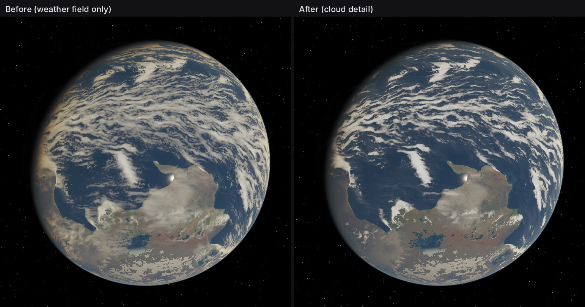
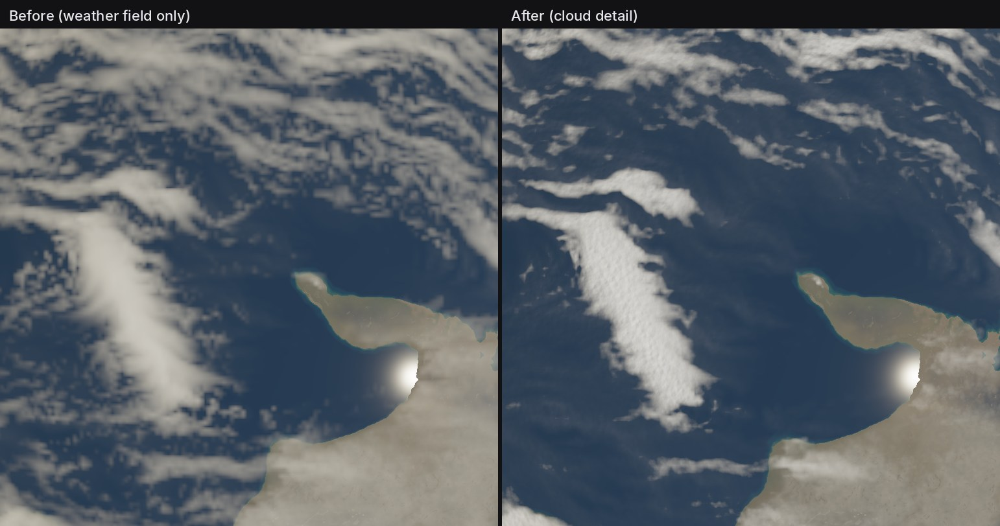

# Preview cloud detail

The preview drew the weather solver's condensate as thin gray veils: the
solver's column optical depth is a normalized amount, not a physical one, and
one texel spans about 26 km. Detail is a preview-only presentation of the same
field, controlled by the `cloud_detail` uniform (Clouds > Detail, default 1).
At 0 the renderer takes exactly the previous path. Export, `clouds.exr`,
`cloud_density.exr` and the Blender bridge are unchanged.

## U1: Physical optical depth

`cloud_detail_multipliers` in `preview_cubemap.wgsl` rescales the low and deep
families per column:

- liquid column depth `d = (0.45 low + 1.65 deep) * 4.5`, the solver's own
  optical weights;
- thickness window `t = clamp((d - 0.05) / 0.30)`, the bridge's contrast map;
  columns below 0.05 (the faint haze between solver ripples) stay clear;
- physical depth `tau = 36 (d - 0.05) * kept * t^0.6`: a 0.35 solver column
  becomes tau ~11, a typical stratocumulus deck, while the `t^0.6` contrast
  curve keeps thin ripples translucent. Review found a flat gain of 50 too
  dense (it merged the fine ripples into white blocks) and a flat gain of 12
  too dim and hazy;
- two-stream shading with g = 0.85: a layer reflects `a tau / (1 + a tau)`,
  a = 0.075, so the Beer-Lambert compositor gets `tau' = ln(1 + a tau)`. Thick
  decks turn bright without clipping to flat white; thin cloud stays
  translucent.

The sun path is scaled by the same multipliers, so puffs shade themselves.

## U2: Billow erosion

Same recipe as the bridge (13.3), on the preview's sphere direction:

- five inverted Worley F1 octaves (cell = 2 weather texels, weights
  0.5/0.24/0.13/0.07/0.04) plus zero-mean wisps, mapped to 0-1 over the
  sums' p5-p95 range;
- `solid = 1 - exp(-3t)`, `erosion = 0.2 * variety * (1 - billow)`,
  `kept = clamp((solid - erosion) / (1 - erosion)) / solid`.

Thin columns break into cumulus over clear sky, margins billow, thick cores
keep the solver's ripples. Detail never adds condensate and ignores the cloud
seed.

## U3: Lattice, filtering and wind

- The weather lookup is warped by up to 0.25 texel along the tangent plane,
  which hides the bilinear texel lattice.
- Octaves fade to their mean once smaller than the pixel footprint, so orbit
  views do not shimmer.
- With wind effects on, billows stretch up to 2.6x along the local wind.
- Noise is evaluated once per pixel, not per ray-march sample.

## U4: Ice

Cirrus keeps the solver's swirls. Ice column depth 0.004-0.04 (a real sheet or
anvil) blends to a 1.6x gain; fainter ice keeps the solver value and gets no
noise.

## U5: Lighting and shadows

- Skylight: cloud tops add `0.24 * blue sky * atmosphere density` of the direct
  irradiance scale, lifting shaded sides and offsetting the reddened beam.
- Surface shadows sample the same eroded column at the sun-offset point, so
  broken cumulus casts broken shadows.
- Relief: the billow octaves also return the slope of their domes. Worley
  supplies it as a soft-minimum blend of unit vectors toward nearby feature
  points, so shading stays continuous across cell borders (the hard nearest
  point faceted like hammered metal). The slope is weighted by octave but not
  by frequency, so large domes shade and fine octaves stay flat, then carried
  through the wind stretch. Direct sunlight scales by
  `1 + 0.6 * clamp(1.2 * slope . sun_tangent)`: sunward sides of each puff
  brighten and lee sides darken at low sun, fading out under a high sun.

## U6: Controls and files

- `PreviewUniforms::cloud_detail` takes over the retained `_pad4` slot (the
  export shader still reads it as padding; `cloud_export_uniforms` pins 0).
- Clouds > Detail slider (0-1, default 1); `PlanetFile::cloud_detail`
  (missing field loads as 1.0).
- `realism_capture` renders `*-no-detail` with `cloud_detail = 0`.

## Captures

Seed 42 at 768 px from `realism_capture`: left `cloud_detail` = 0 (the
previous preview), right the default detail.

## Verification

- `cloud_detail_does_not_turn_uniform_decks_into_noise_masks`: 0.8 decks of
  each family keep no holes and under 6% ripple in optical depth.
- `cloud_detail_breaks_thin_uniform_veils_into_cloud_and_clear_sky`: a 0.04
  low deck breaks into clear sky (under a quarter of its p95 depth) between
  surviving cloud (over half).
- `cloud_detail_adds_no_cloud_or_shadow_to_clear_sky_and_ignores_cloud_seed`:
  empty weather renders bit-identically with detail 0 and 1; cloud seeds do
  not change the detailed render.
- Existing preview tests run with `cloud_detail = 0` and keep their results.
- Captures for seeds 42, 73 and 137: crisp white clouds, clear land and
  ocean between them, storm and cirrus swirls kept, no texel blocks.
- Lavapipe preview render time +16-24% with detail on.
